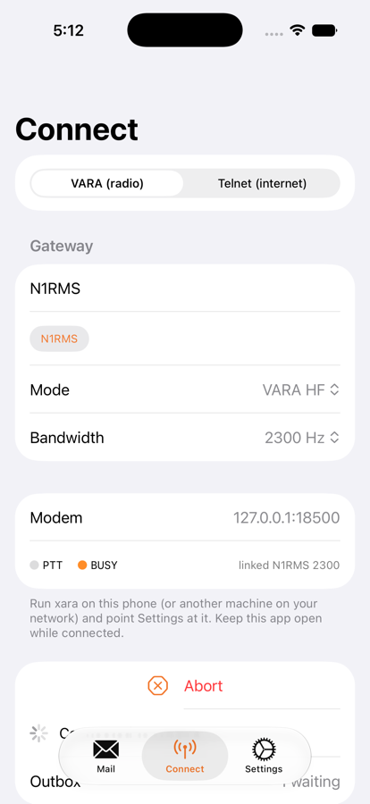
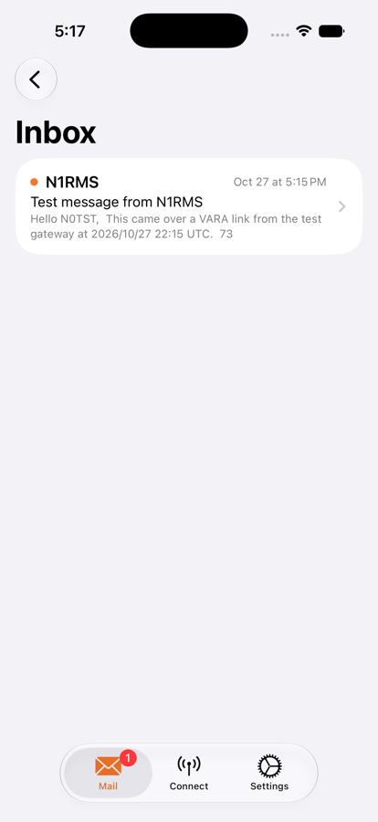
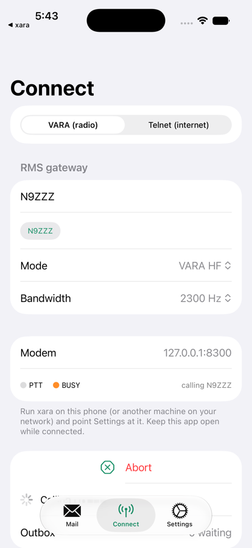
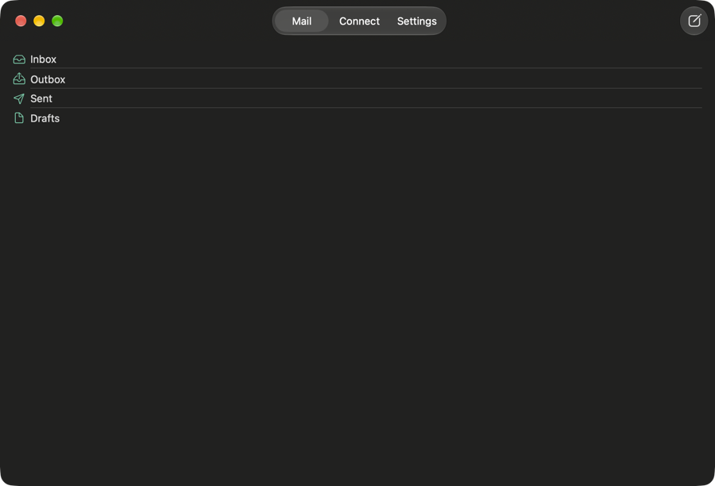

# Gateway: an open-source Winlink client for iPhone and Mac

Gateway sends and receives Winlink radio email. Over the air it talks to a Winlink gateway (RMS)
through a **VARA modem over TCP**: [xara](../xara) on the same device (`127.0.0.1`: the xara
iPhone app, or the `xara` command / Xara.app on a Mac), or xara/VARA elsewhere on your network.
It can also reach the Winlink CMS over the internet by telnet. One SwiftUI target builds both the
iOS app (`com.nr5p.gateway`) and the macOS app (`com.nr5p.gateway.mac`); all protocol, transport
and model code is shared.

<p>



</p>
<p></p>

- **Mail**: Inbox, Outbox, Sent, Drafts; compose with To/Cc/Subject/body and file attachments;
  reply, reply-all, forward; attachments open through the share sheet.
- **Connect**: VARA HF (500/2300/2750 Hz) or VARA FM, gateway call sign (recent ones are
  remembered), live PTT/BUSY/link state, transfer progress, Abort; or Telnet to the CMS.
- **Settings**: call sign, grid locator, Winlink password (Keychain, this device only),
  modem host and command port (data port = command port + 1), CMS host/port; on the Mac, the
  command used to start xara and whether to stop it on quit.
- **Session log**: B2F protocol lines and modem commands, shareable.

Everything is Swift: no Go, Rust or other runtime is linked into either app, and there are no
third-party dependencies. MIT licence.

## Why a Swift port, not gomobile

Pat (Go) and its protocol library [wl2k-go](https://github.com/la5nta/wl2k-go) are the mature
open-source Winlink stack, and both are MIT-licensed (no GPL, so App Store distribution is fine).
I ported the parts a client needs to Swift (`WinlinkKit`) instead of embedding Go with gomobile:

- The protocol part is small: the `fbb` package (B2F forwarding, message format, secure login)
  is about 2,500 lines of Go with comments, and `lzhuf` about 900. The Swift library is about
  2,500 lines including the VARA and telnet transports.
- gomobile would add a Go toolchain, a ~10 MB xcframework and a cgo bridge to every build, plus
  Go's own goroutine/network runtime on iOS, for code that is mostly string handling.
- A native port lets the transports use Network.framework and Swift concurrency directly, and the
  library and its tests build with plain `swift test`.

wl2k-go's own test vectors were ported too (see below), so the port can be checked against it.
The VARA command sequence follows Pat's VARA driver
([Pat-Vara](https://github.com/n8jja/Pat-Vara), MIT). Licence texts for the ported code are in
`WinlinkKit/LICENSE.wl2k-go` and `WinlinkKit/COPYRIGHT.lzhuf`.

## Layout

```
Gateway.xcodeproj       one multiplatform app target: iOS 17+ and macOS 14+, Swift 5 mode,
                        team G4GK5372G8, bundle ids com.nr5p.gateway / com.nr5p.gateway.mac
Gateway/                SwiftUI app: mail store, session controller, views, Platform.swift
                        (iOS/macOS differences), ModemLauncher.swift (macOS: start xara)
WinlinkKit/             Swift package: the protocol and transports
  Sources/WinlinkKit/
    LZHUF.swift           LZHUF compression with the B2 CRC16 header
    Message.swift         Winlink message format, addresses, RFC 2047 words, MIDs
    Proposal.swift        FC proposals, FS answers, secure login response
    B2FSession.swift      the B2F exchange (client or master)
    VARAModem.swift       VARA command/data port client (CONNECT, LISTEN, BUFFER, PTT, ...)
    TCPStream.swift       Network.framework TCP
    Telnet.swift          CMS telnet login
  Sources/TestGateway/  `test-gateway`: a stand-in RMS that answers VARA calls (macOS)
  Tests/                unit tests and live-xara integration tests
tools/make-icons.swift  draws the app icons (iOS 1024 px, macOS 16-1024 px)
tools/xara-airlink/     two xara modems linked by simulated audio, for end-to-end tests
```

## Using it with xara

**iPhone, xara on the same phone.** Start the xara iOS app (it keeps running in the background
with background audio), connect the radio interface and tap Start. Then in Gateway:

1. Settings: your call sign, grid, Winlink password. Modem host `127.0.0.1`, port `8300`.
2. Compose a message; it waits in the Outbox.
3. Connect: VARA HF (or FM), the gateway's call sign (e.g. from the Winlink RMS list), bandwidth,
   then **Connect**. Gateway sends `MYCALL`, `BW…`, `CONNECT <you> <gateway>`, waits for
   `CONNECTED`, runs the B2F exchange (secure login, sends your Outbox, downloads your mail), and
   disconnects.

Keep Gateway in the foreground while connected (it keeps the screen awake): iOS suspends apps
that are not playing audio, and a suspended client drops the session.

**Mac.** Leave the modem host at `127.0.0.1`. When nothing answers on the command port, Gateway
starts xara itself:

1. if Xara.app (`io.github.x0rro.xara.mac`) is installed, it opens `xara://start` and waits up to
   10 s for the port;
2. otherwise, or if Xara.app does not answer on that port, it runs the `xara` command (from
   `~/.cargo/bin`, `/opt/homebrew/bin` or `/usr/local/bin`) with the command line in Settings,
   `{call}` and `{port}` filled in, logging to `~/Library/Logs/Gateway/xara.log`. Name your
   radio's audio interface there (`xara --list-devices`); xara refuses to transmit into the
   default output.

If neither exists it says so. The modem keeps running when Gateway quits, since other clients
may use it; *Stop xara when Gateway quits* stops only a modem Gateway itself started. The Mac app
is not sandboxed, because it may need to run the `xara` command.

**Another machine.** Point the modem host at it: xara on a Mac/Linux box
(`--addr 0.0.0.0`), or the xara iPhone app with *Accept clients on the local network* on.
iOS asks for local-network permission the first time.

**Telnet.** Pick *Telnet (internet)* on the Connect tab: it logs in to `server.winlink.org:8772`
and runs the same exchange with no radio.

## What was tested, and how

All of this runs on a Mac; `swift test` needs nothing else.

| What | How | Result |
|---|---|---|
| LZHUF | wl2k-go's vectors: 4 inline samples and 5 files (Gettysburg, e, pi, a real B2F message, *Tom Sawyer*), compressed and decompressed **byte-for-byte** against the reference `.lzh` files; bad CRC, truncation, no-CRC mode | pass |
| Secure login | wl2k-go's vectors (`23753528`/`FOOBAR` → `72768415`, `FooBar` → `95074758`) | pass |
| B2F protocol | wl2k-go's session tests against a scripted CMS (handshake lines, `FS =` deferral, CMS v4 `;PM`/`;WARNING` lines), `FS` answer parsing incl. offsets, proposal sorting by precedence, `;FW`/`;PM` parsing, login-failure detection; plus a byte-level scripted gateway exchange (proposal checksum, SOH/STX/EOT framing, an inbound message with a non-ASCII subject and an attachment) and a P2P exchange between two of our own sessions | pass |
| Message format | wire format, header order, RFC 2047 subjects/file names (Q and B, ISO-8859-1 and UTF-8, raw Latin-1), date layouts, address forms, validation | pass |
| Telnet login | CMS prompts against a scripted server, including bytes arriving with the password prompt | pass |
| VARA client vs the **real xara binary** | `XARA_CMD_PORT=18300 swift test`: `VERSION` (`VARA HF v4.9.0`), `PUBLIC`/`CWID`/`COMPRESSION`/`MYCALL`/`LISTEN OFF`/`BW2300`/`WINLINK SESSION` all `OK`, `CONNECT` keys the transmitter (`PTT ON`), cancel sends `ABORT`, modem back to idle | pass |
| **B2F over a VARA ARQ link between two xara modems** | `tools/xara-airlink` links two xara modems through simulated audio, each with real VARA TCP ports. Our client calls N2TST, our master-side session answers through `LISTEN ON`, and a message goes each way (one with an attachment), with `BUFFER` flow control and `DISCONNECT`/`DISCONNECTED` | pass (~2 min) |
| **iOS app ↔ xara iOS app (127.0.0.1)** | Both apps in one simulator; xara (local clients only) bound 127.0.0.1:8300/8301 after the Mac's modem freed the port. Gateway opened in front, xara in the background: both ports connected (checked with `lsof`), every setup command `OK`, `CONNECT N0TST N9ZZZ` (*calling N9ZZZ*, BUSY), Abort. xara kept running and listening afterwards | pass |
| **iOS app ↔ xara iOS app (LAN)** | Both apps in one simulator (iPhone 17 Pro, iOS 27), xara started with *Accept clients on the local network*, then sent to the background by opening Gateway. Gateway connected to `192.168.10.234:8300` (the Mac's LAN address; the simulator shares its network): `VERSION VARA HF v4.9.0`, every setup command `OK`, `CONNECT N0TST N9ZZZ` (state *calling N9ZZZ*, BUSY reported), Abort. xara kept running and listening throughout | pass |
| **macOS app ↔ installed `xara` (0.1.1)** | `xara --call N1TST --capture NMAudioDevice_UID --playback NMAudioDevice_UID --port 18300 --kiss-port off` running; the Mac app opened it, all setup commands `OK`, `CONNECT N0TST N9ZZZ`, xara logged `tx c26 Calling` with PTT | pass |
| **macOS auto-start** | Nothing on 18300, Xara.app installed (serving 8300 only): Gateway opened `xara://start`, waited 10 s, fell back to `~/.cargo/bin/xara` with the Settings command line, and placed the call. Quitting left xara running; with *Stop xara when Gateway quits* on, it stopped the xara it had started and left Xara.app alone | pass |
| **The app in the iOS simulator** | The iOS app (iPhone 17 Pro, iOS 27) on the airlink against `test-gateway --password SECRET`: the call linked (`CONNECTED N0TST N1RMS 2300`). With a wrong password the gateway refused the secure login and the app said *Login failed*. With the right one, the message composed in the app was delivered, the gateway's message arrived in the Inbox, and the Outbox emptied | pass |
| Builds | `xcodebuild` for macOS, iOS Simulator and an iOS device (signed with team G4GK5372G8) | pass |

### Running the tests

```sh
cd WinlinkKit && swift test            # unit tests; live-modem tests are skipped
```

Against xara (from `~/Desktop/xara`, after `cargo build --release -p xara`):

```sh
./target/release/xara --call N1TST --capture NMAudioDevice_UID --playback NMAudioDevice_UID --port 18300 --kiss-port off
```

```sh
cd tools/xara-airlink && cargo build --release && ./target/release/xara-airlink 18500 18600
```

```sh
cd WinlinkKit && XARA_CMD_PORT=18300 XARA_AIRLINK=18500,18600 swift test
```

The Mac app has a Debug-only test hook: launched with `-autoConnect` it starts a session with
its saved settings, and Debug builds copy the session log to stderr:

```sh
build/dd/Build/Products/Debug/Gateway.app/Contents/MacOS/Gateway -autoConnect
```

To try the app against the airlink, run a stand-in gateway on station B and point the app
(Settings → port `18500`, gateway `N1RMS`) at station A:

```sh
cd WinlinkKit && swift run test-gateway --call N1RMS --port 18600 --password SECRET
```

`xara-airlink` expects the xara source tree next to this repository (`../xara`). Two real xara
processes sharing the NoMachine virtual audio device hear each other but never finish the
handshake, which is why the airlink tool exists.

## Not tested

- **A real over-the-air session with an RMS.** That needs a radio, an interface (e.g. Digirig),
  a licence, a Winlink account and a gateway in range. Everything up to the audio is tested above;
  the gateway side was our own B2F master, not RMS Trimode.
- **The live Winlink CMS**, over telnet or through a gateway. Only scripted CMS sessions were run.
  The first real login will show whether the CMS accepts the `Gateway` SID.
- **Either app on a real device.** Everything above ran in the simulator or on this Mac.
- **Xara.app cold start.** Gateway's `xara://start` launch ran, but Xara.app was already running
  (serving another port), so that session went through the CLI fallback. Starting Xara.app from
  not-running was not tried, because it was in use.
- **The Mac app driven by clicking.** No desktop-automation tool was available, so the Mac app was
  run through its `-autoConnect` hook; the same views were driven by hand in the iOS simulator.
- **Real VARA (Windows).** The client only does what Pat does, and it treats a missing reply to
  `PUBLIC`/`CWID`/`COMPRESSION`/`LISTEN` as harmless, but it was only run against xara.
- **VARA FM against xara**, P2P sessions from the app, and B2F resume offsets (parsed and honoured
  when sending, never requested when receiving, as in wl2k-go).
- Gzip (`FD`) proposals are deferred, as in wl2k-go unless its experiment flag is set.

## Notes

- The B2F SID sent is `[Gateway-<version>-B2FHM$]`.
- xara (like VARA) answers `WRONG` to `MYCALL`/`BW` while a link is still closing, for example
  one left by a client that went away; Gateway retries those for up to 15 s.
- Messages are stored as raw B2F files under Application Support/Mail/<folder>.
- `WinlinkKit` builds with `-O` even in Debug, because LZHUF walks a tree for every byte.
